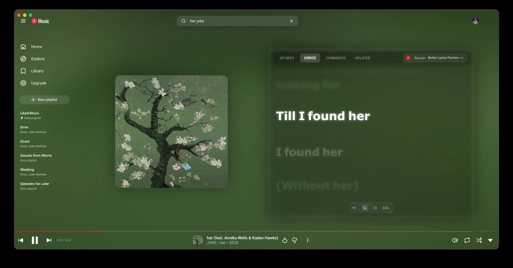

# 🎵 Play Music

**A desktop app for YouTube Music — native window, synced lyrics, visual effects, and quality-of-life features.**

    More screenshots: <a href="web/demo/screenshot.md">here</a>

---

## What is this?

Play Music is a desktop wrapper around the real [music.youtube.com](https://music.youtube.com) web app — it does not reimplement or bundle YouTube Music's catalog or backend. It loads the actual site inside a native Electron window (an internet connection and Google/YouTube account are required to play anything), then layers on top of it:

- **A native desktop shell** — system tray controls, media key support, global shortcuts, and window management that the browser version doesn't offer.
- **Injected plugins and browser extensions** that enhance the page: an ad blocker, synced lyrics with animated scrolling ("PlayMusicFlow"), ambient background shader effects, Discord Rich Presence, Last.fm scrobbling, SponsorBlock, precise volume control, and more — all toggleable from the in-app menu.

It's built on [pear-desktop](https://github.com/pear-devs/pear-desktop), a fork of [th-ch/youtube-music](https://github.com/th-ch/youtube-music), with additional lyrics and visual plugins added on top.

## Features

- 🎵 **Better Lyrics** — synced lyrics with custom themes and animated scrolling
- 🎨 **Shader effects** — ambient background visuals synced to the current track
- 🛡️ **Built-in ad blocking**
- ⏯️ **Non-Stop playback** — bypasses the "Video paused. Continue watching?" prompt
- 🎮 **Discord Rich Presence**, Last.fm scrobbling, SponsorBlock, precise volume, and more via the plugin system

## Development

See the [Developer Guide](dev.md) for local setup, running in dev mode, and writing plugins.

## License

- **GPL-3.0** © [Kevin John Mathew](https://github.com/kevin-john-mathew)
- Based on [pear-desktop](https://github.com/pear-devs/pear-desktop) ([MIT © pear-devs](NOTICE))

## Credits / Acknowledgements

This project builds on the work of the open-source community:

### Core Projects & Features
* **[Pear Desktop](https://github.com/pear-devs/pear-desktop)** — the base application this project is built upon.
* **[Better Lyrics](https://github.com/better-lyrics/better-lyrics)** — enhanced lyrics integration.
* **[Better Lyrics Shader](https://github.com/better-lyrics/shaders)** — background shader visual effects.
* **[NonStop+](https://chromewebstore.google.com/detail/youtube-nonstop-ch%E1%BA%B7n-t%E1%BB%B1-%C4%91/fboblaiflnpfojmmnenhacobmckefmlh)** — logic used to bypass the "Video paused" prompts.

### Theme Inspirations
* **[chengggit](https://github.com/chengggit)** — *Dynamic Background* ([YouTube-Music-Dynamic-Theme](https://github.com/chengggit/YouTube-Music-Dynamic-Theme))
* **zobiron** — *Big Blurry Slow Lyrics for TV* concept
* **SKMJi** — *Luxurious Glass* design
* **[tposejank](https://github.com/tposejank)** — lyrics style from the *[Apple Music theme for Better Lyrics](https://github.com/tposejank/blyrics-am-theme)*
* **[WolfTheE](https://github.com/WolfTheE)** — *[Better-YTM](https://github.com/WolfTheE/better-ytm)* theme

## FAQ

**Why isn't the app menu showing up?**
If `Hide Menu` is on, press <kbd>Alt</kbd> to show it (or <kbd>\`</kbd> if using the in-app-menu plugin).

**Why is the minimum window size locked at 1280x720?**
The app isn't designed for small window sizes. Disable this under **Options → Advanced options → Disable Minimum Window Size**.

**Can I customize it?**
Yes — fonts and custom CSS can be set in the Better Lyrics settings, and most visual plugins are configurable from the in-app menu.

---

> [!NOTE]
> This project is not affiliated with, authorized by, endorsed by, or in any way officially connected with Google LLC, YouTube, or any of their subsidiaries. "Google" and "YouTube Music" are trademarks of their respective owners. Provided "AS IS" with no warranty — see [LICENSE](LICENSE) for full terms.
